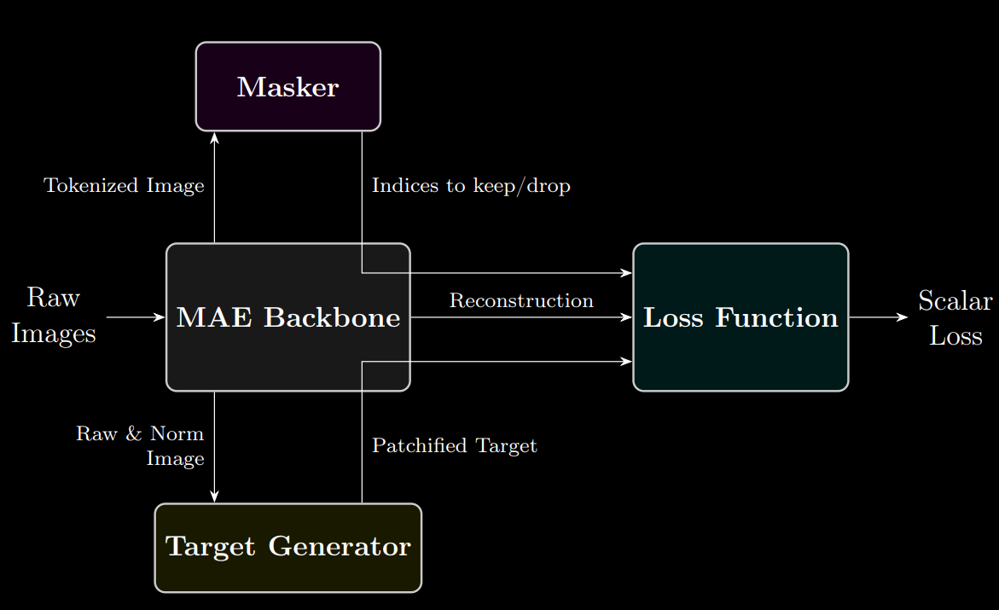
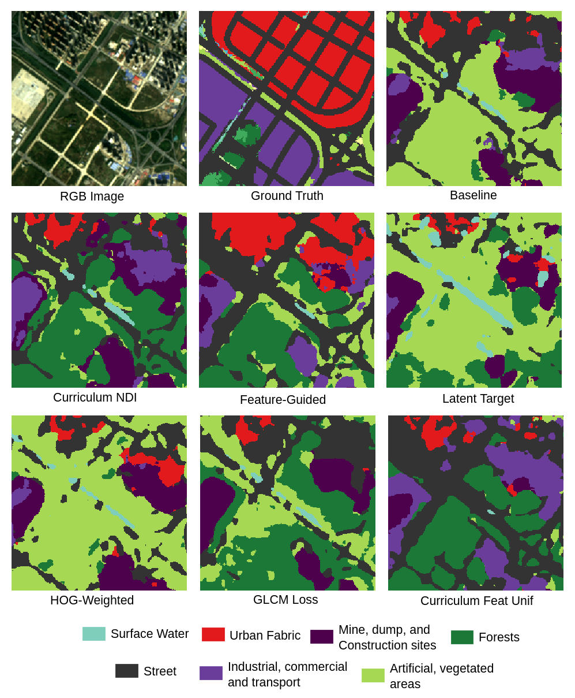

# Remote Sensing Masked Autoencoders (RS-MAE)

Current remote sensing literature often introduces heavily coupled foundation models; bundling a custom backbone, a specialized mask, a novel feature target, and an auxiliary loss function all at once. This makes it hard to isolate which specific component actually drives downstream semantic segmentation performance. This thesis decouples the MAE pipeline to answer: **Which mechanisms actually matter?**

## The Decoupling Framework
We isolate the MAE pipeline into three interchangeable pillars, allowing us to evaluate individual modifications fairly under identical compute constraints.



**Methods Evaluated:**
- **Masking:** NDI Spectral Saliency Curriculum (via localized Coefficient of Variation) and Stochastic Mixed-Batch Regularization (half-normal distribution sampling).
- **Targets:** Feature-Guided (Max-Gradient HOG & NDI) and Latent (asymmetric momentum self-distillation).
- **Losses:** HOG-Weighted Loss (dynamic un-normalized saliency) and Differentiable GLCM Texture Loss (KDE soft-binning for end-to-end backprop).

*All methods were evaluated across 6 diverse downstream segmentation tasks, including rigorous geographic Out-of-Distribution (OOD) transfer.*

## Key Takeaways: The Hierarchy of MAE Components

1. **Targets > Everything Else:** Predicting physics-aware features (HOG + NDI) instead of raw pixels yields the highest performance gains.
2. **Smart Masking is Niche:** Saliency-guided masking accelerates learning on boundary-heavy tasks, but random masking eventually catches up given enough compute.
3. **Losses Require Care:** Custom losses are safe as mild MSE regularizers, but complex formulations polarize performance.
4. **Priors Require Domain Match:** For architectural priors to succeed, the target domain *must* align with the visual characteristics of the prior (e.g., the HOG target excels in urban environments because it explicitly captures rigid, man-made geometries). Combining multiple priors heavily increases the risk of overfitting to the pretraining domain.
5. **Geographic Generalization is Fragile:** Because priors overfit to the pretraining geography, the **OOD test acts as a strict equalizer**. Complex modifications degrade on unseen climates, while simple random masking and raw pixel reconstruction remain the most robust setup for generalizable transfer.
6. **Data Quality > Quantity:** Strict curation (e.g. filtering clouds/snow) beats scaling uncurated data.

## Setup & Configuration

Install the required dependencies via the provided conda environment:
```bash
mamba env create -f environment.yml
mamba activate rs_mae
```

Path configurations for datasets and outputs are managed by Hydra. Adjust the paths for your local setup or cluster environment in `configs/paths/local.yaml` or `configs/paths/cluster.yaml`.

## Data

The repository supports several datasets. You must acquire and prepare them according to their respective literature:
- **BigEarthNet v2.0 (reBEN)**
- **reBEN 7k**
- **m-cashew-plantation**
- **MMHunan**
- **C2Seg** (Cross-City Semantic Segmentation Augsburg-Berlin, and Beijing-Wuhan)

## Usage

The project relies heavily on Hydra for configuration. You can easily switch between datasets and experiments using the command line.

### Pretraining
To run self-supervised pretraining using `train/pretrain.py`:
```bash
python train/pretrain.py experiment=baseline
```

### Downstream Fine-Tuning
To fine-tune a pretrained model for semantic segmentation using `train/finetune.py`:
```bash
python train/finetune.py experiment=baseline dataset=cashew_plantation
```

### Evaluation & Visualization
Scripts for evaluating models and plotting true-color qualitative comparisons are provided in the `checks/` directory. For example, to generate side-by-side segmentation results:
```bash
python checks/plot_inference.py
```

## Qualitative Results



### Experiment Tracking
All experiments, training curves, and evaluation logs for this thesis are publicly accessible on Weights & Biases (W&B):
[View Run Logs on W&B](https://wandb.ai/jacer-technical-university-of-berlin/RS_MAE-Thesis/table?nw=nwuserjacer)

## Engineering Highlights: Solving OOM on Large Tiles
Beyond the experiments, this codebase offers a robust, model-agnostic pipeline to solve **Out-of-Memory (OOM) errors and grid artifacts** on massive images (e.g., satellite or medical scans).
- **Scalable Data Loading:** `StochasticGridDataset` for stochastic grid-sampling on arbitrary large tiles.
- **Seamless Inference:** `windowed_inference` for artifact-free, memory-safe sliding window predictions.
- **OOM-Free Evaluation:** `windowed_evaluation` for calculating metrics on massive predictions without crashing the GPU.

> 💡 **Standalone Utilities:** The `StochasticGridDataset` class and the `windowed_inference` / `windowed_evaluation` functions are entirely model-agnostic. Feel free to drop them into your own projects to handle large tiles effortlessly!
> 
> For an interactive demonstration, check out the Jupyter Notebook: [`checks/large_tile_ds.ipynb`](checks/large_tile_ds.ipynb)

### Minimal Working Example
```python
from datasets.segmentation_ds import StochasticGridDataset
from utils.spatial_ops import windowed_inference, windowed_evaluation

# 1. Train seamlessly on massive tiles
train_ds = StochasticGridDataset(huge_images, huge_masks, grid_sampling=True, crop_size=256, min_margin=128)

# 2. Artifact-free inference (merged on CPU to save VRAM)
pred_logits = windowed_inference(model, huge_images, window_size=256, stride=128, batch_size=16, merger_device="cpu")

# 3. Safely evaluate metrics without crashing the GPU
windowed_evaluation(pred_logits, huge_masks, tile_size=5000, eval_batch_size=3, torchmetrics=[mIoU])
```

## Key References

- **[SIGMAE]** Zhang et al., "SIGMAE: A Spectral-Index-Guided Foundation Model for Multispectral Remote Sensing," 2026. arXiv:2603.07463.
- **[FG-MAE]** Wang et al., "Feature Guided Masked Autoencoder for Self-supervised Learning in Remote Sensing," 2023. arXiv:2310.18653.
- **[S2HM2]** Tu et al., "S²HM²: A Spectral–Spatial Hierarchical Masked Modeling Framework for Self-Supervised Feature Learning," TGRS 2024.
- **[SelectiveMAE]** Wang et al., "Harnessing Massive Satellite Imagery with Efficient Masked Image Modeling," 2025. arXiv:2406.11933.
- **[GLCM-MAE]** Madan et al., "Focus on Texture: Rethinking Pre-training in Masked Autoencoders for Medical Image Classification," 2025. arXiv:2507.10869.